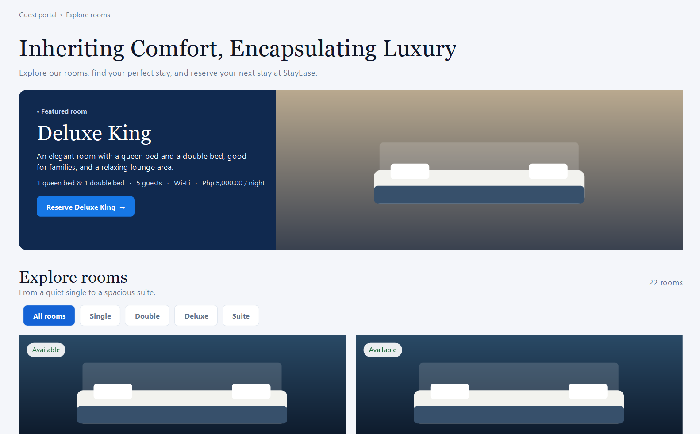
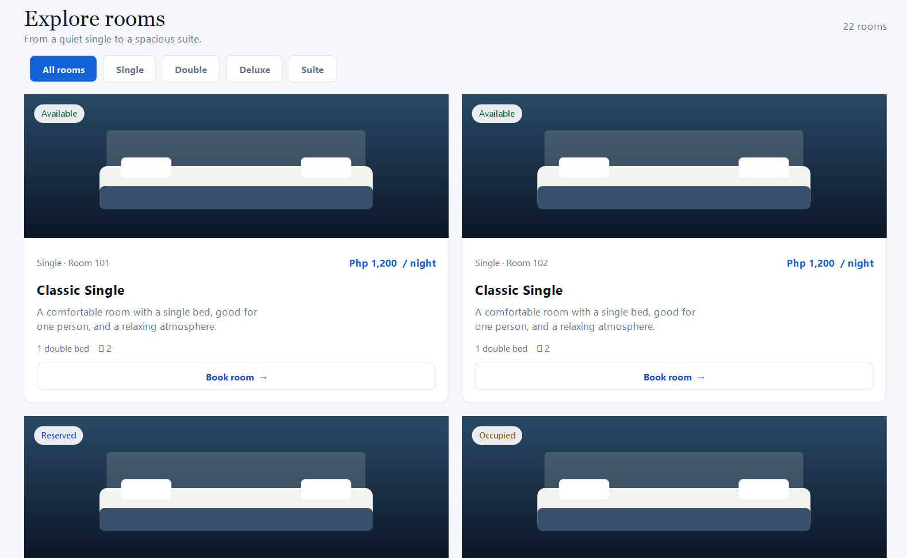
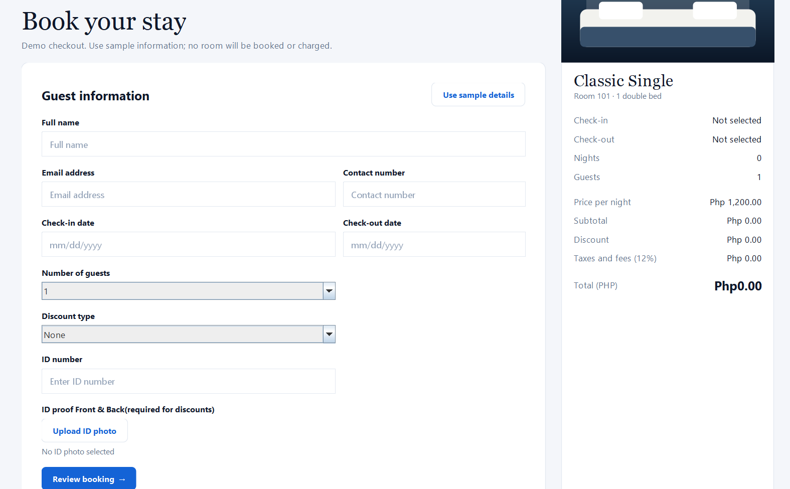
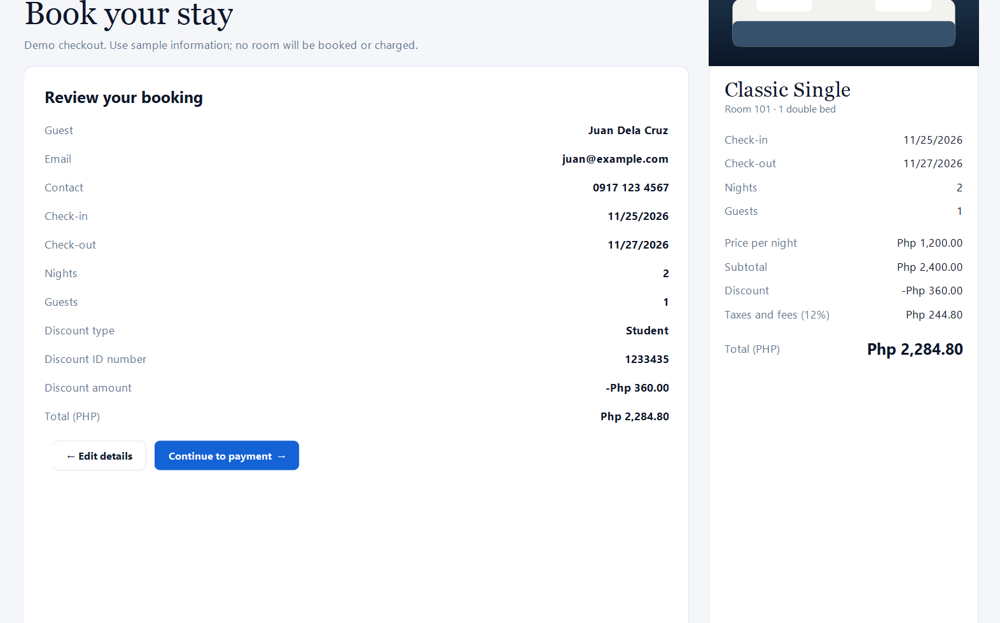
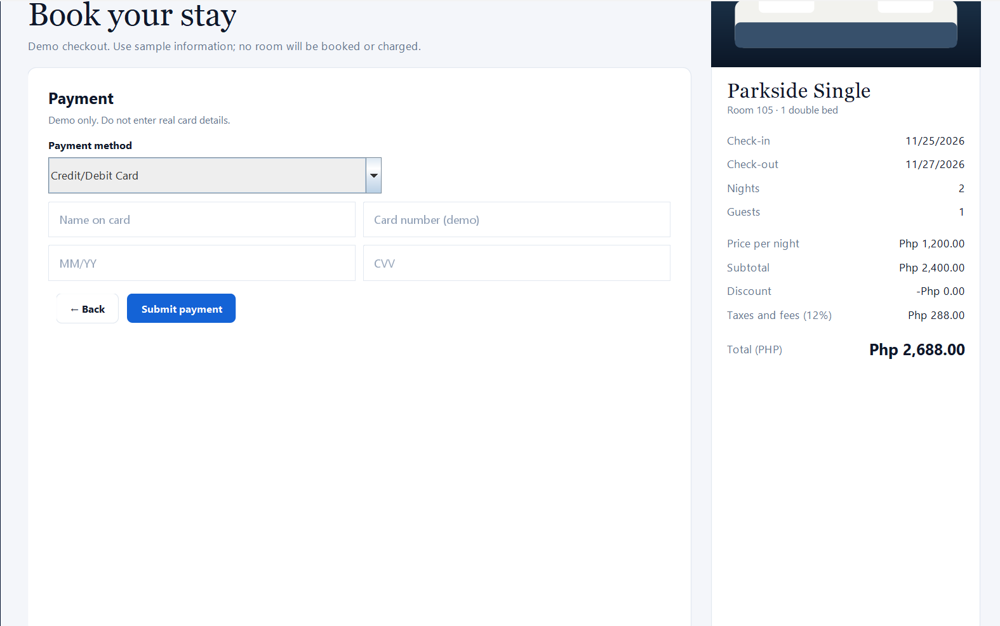
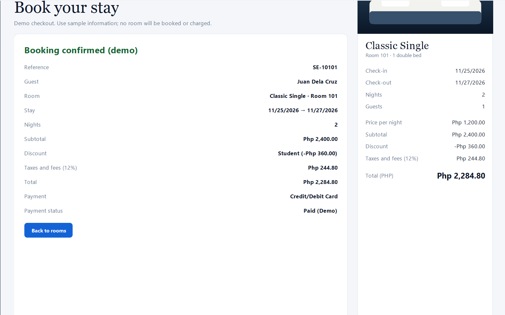
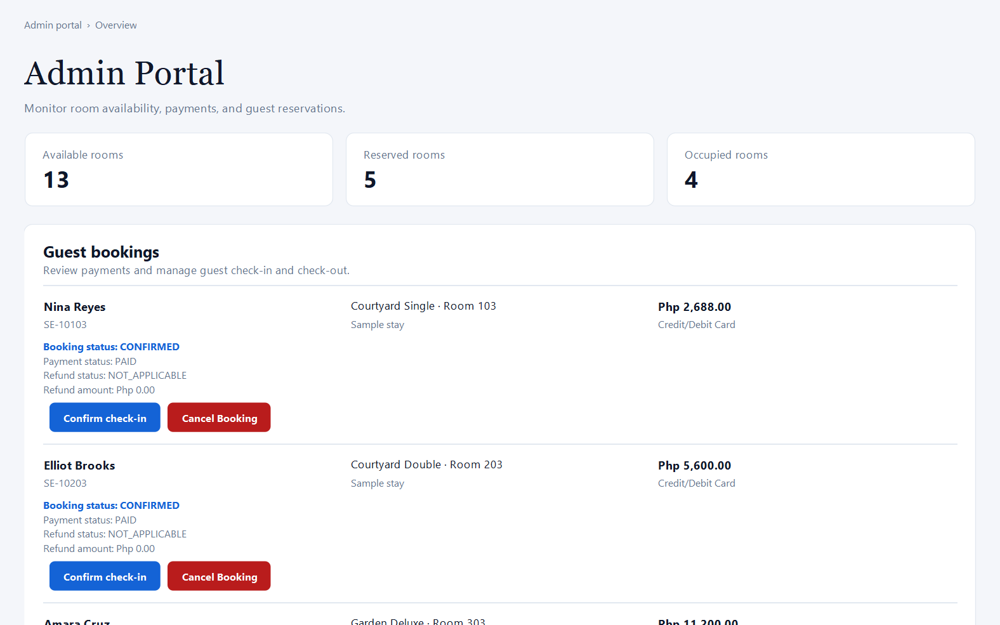
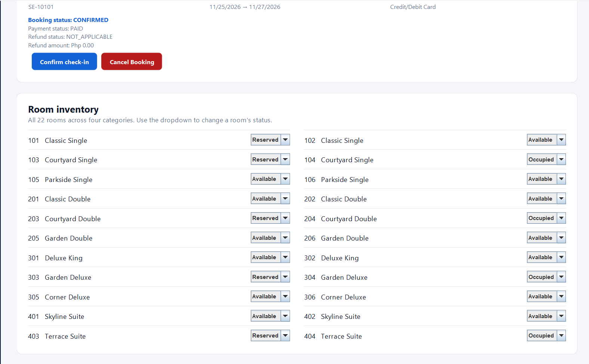

# StayEase: Hotel Booking and Reservation System

> Making hotel reservations easier, faster, and more organized through a user-friendly desktop application.

---

## Project Description

StayEase is a Java-based Hotel Booking and Reservation System developed using Java Swing for its graphical user interface (GUI). It allows guests to browse hotel rooms, check room availability, view room details and prices, and make reservations.

The system also provides an Administrator Portal where administrators can manage room statuses, monitor guest bookings, verify payment submissions, and handle guest check-in and check-out. It aims to make hotel reservation processes more convenient and organized for both guests and hotel administrators.

## Problem Being Addressed

Hotel guests often experience difficulties when searching for suitable rooms, comparing prices, and checking room availability. When hotel room information and reservations are managed manually, it can become difficult to organize booking records and monitor room statuses.

Who experiences this problem?
- Hotel guests who need an easier way to browse rooms, compare prices, and make reservations.
- Hotel administrators who need to monitor room availability and manage guest booking records.

What are the current pain points or gaps?
- Difficulty checking available rooms and comparing room categories.
- Manual organization of guest reservation records.
- Difficulty monitoring room statuses and booking information.
- Lack of an organized way to review booking costs and reservation details.

Why is it worth solving?
Developing an organized hotel reservation system can make the booking process more convenient for guests and easier to manage for administrators. It helps reduce confusion when checking room information, provides clear booking cost calculations, and improves the organization of hotel reservations.

## Project Objectives

**General objective:**
To develop a Java Swing-based Hotel Booking and Reservation System that allows guests to browse rooms, submit and review reservations, and receive booking receipts, while enabling administrators to monitor bookings, verify payment submissions, manage room statuses, confirm guest check-in and check-out, cancel eligible bookings, and record refunds.

**Specific objectives:**
1. Develop a Java Swing desktop application with separate Guest and password-protected Admin portals.
2. Display 22 sample hotel rooms across Single, Double, Deluxe, and Suite categories, including room descriptions, prices, bed information, capacities, and room statuses.
3. Allow guests to browse and filter room cards by category and select rooms marked as Available.
4. Collect guest information, check-in and check-out dates, guest count, and applicable discount information with input validation.
5. Calculate booking costs, including the subtotal, eligible 15% Student/PWD/Senior Citizen discount, 12% tax, and final total.
6. Provide simulated Cash, Credit/Debit Card, and GCash payment options.
7. Enable administrators to review bookings, approve or reject pending GCash payments, confirm check-in and check-out, update room statuses, and cancel eligible bookings.
8. Record applicable refunds for eligible cancelled reservations.

## Target Users

| User Type | Description | How They Use the System |
|-----------|-------------|-------------------------|
| Admin | Hotel administrators responsible for managing reservations and room information. | Browses room categories, checks availability, views prices, enters booking information, submits simulated payments, and receives booking receipts. |
| Guest | Individuals who want to reserve hotel rooms | Accesses the administrator portal, monitors bookings, verifies GCash payments, updates room statuses, manages check-in/check-out, and handles eligible cancellations and refunds. |

## Main Features

- **Guest Room Browsing:** Displays 22 sample hotel rooms categorized into Single, Double, Deluxe, and Suite. Guests can view room descriptions, prices, bed information, capacity, and availability.
- **Room Category Filtering:** Allows guests to filter rooms according to their preferred room category and select rooms marked as Available.
- **Guest Booking Form:** Collects guest name, email address, contact number, check-in and check-out dates, and number of guests. It also validates the entered information.
- **Booking Cost Calculation:** Automatically calculates the number of nights, room subtotal, applicable discount, 12% tax, and final booking amount.
- **Payment System:** Provides simulated Cash and Credit/Debit Card payments, as well as GCash submission with transaction details and screenshot for administrator verification.
- **Booking Receipt:** Displays the booking confirmation, reference number, and payment summary.
- **Administrator Portal:** Provides a password-protected dashboard for viewing booking records, room inventory, and room availability.
- **Payment Verification:** Allows administrators to review GCash submissions and approve or reject pending payments.
- **Room and Reservation Management:** Allows administrators to update room statuses, confirm guest check-in and check-out, and cancel eligible reservations.
- **Refund Management:** Records full refunds for eligible paid or approved bookings cancelled at least three days before check-in. Cancellations made less than three days before check-in receive no refund.


## Technologies Used

| Category | Technology |
|----------|------------|
| Language | Java |
| IDE / Editor | VS Code |
| Libraries / Frameworks | Java Swing |
| Database / Storage | Java Collections (ArrayList) and sample in-memory data |
| Version Control | Git / GitHub |

## Team Members and Roles

| Name | Role | Responsibilities |
|------|------|------------------|
| MORENO, JUSHLEY R. | Project Leader | Guides the group, tracks deadlines, and keeps the project on schedule. |
| SULIT, CECILE A. | Lead Programmer | Leads the coding of Java classes, methods, and OOP features. |
| DUBLA, ALTHEA NECOLE O. | System/Design Lead | Plans the system requirements, class designs, UML diagrams, and overall program layout. |
| MAGALING, CELINE B. | Documentation | Updates the README, test records, and screenshots, and helps check that all features work properly. |

## OOP Concepts Demonstrated

| Concept | Where It Is Applied | Explanation |
|---------|---------------------|-------------|
| **Encapsulation** | `Model.java, Service.java` | Groups related data and operations into classes such as Room, Booking, Hotel, and Service. Data access is managed through appropriate methods and validation. |
| **Inheritance** | `GuestPortal.java, AdminPortal.java, Portal.java` | GuestPortal and AdminPortal extend the shared Portal class, allowing them to reuse common GUI components and methods. |
| **Polymorphism** | `Custom Java Swing Components` | Demonstrates method overriding through methods such as paintComponent(), which customizes the appearance of GUI components. |
| **Abstraction** | `Portal.java, Model.java, Service.java` | Separates graphical interface components, data structures, and business operations to organize the application and hide unnecessary implementation details. |

## Instructions for Running the Program

### Prerequisites
- Install the Java Development Kit (JDK).
- Install Visual Studio Code.
- Install the Java Extension Pack in Visual Studio Code.
- Make sure Java is properly configured on your computer.
  
### Steps
1. Clone or download the repository:
   ```bash
   git clone https://github.com/username/repository-name.git](https://github.com/celinebm11/StayEase-Hotel-Booking-and-Reservation-System-
   ```
2. Open the project folder:
   ```bash
   cd StayEase-Hotel-Booking-and-Reservation-System-
   ```
3. Compile the Java files::
   ```bash
   #javac *.java
   ```
4. Run the application:
   ```bash
   java MainMenu
   ```
5. The StayEase application window will appear. Choose the Guest Portal or Admin Portal to access the available functions.

## Sample Screenshots

| Screen | Preview |
|--------|---------|
| Main Menu |  |
| Guest Portal |  |
| Room Browsing |  |
| Booking Form |  |
| Booking Summary |  |
| Payment Interface |  |
| Booking Receipt |  |
| Admin Dashboard |  |
| Booking Management |  |


## Known Limitations

- Limitation 1 (e.g., data is not saved after closing the program)
- Limitation 2 (e.g., no input validation for ...)
- Limitation 3

## Future Improvements

- [ ] Improvement 1
- [ ] Improvement 2
- [ ] Improvement 3

## Project Contributors

- **Full Name** – Role – [GitHub/Email]
- **Full Name** – Role – [GitHub/Email]
- **Full Name** – Role – [GitHub/Email]

---

*Course / Section / School Name – Academic Year*
